I study computer science and data science at NYU's College of Arts and
Science, class of 2028.
I am working toward AI engineer and ML engineer roles.
My projects cover the whole loop: train a model, find the right data for
the model, serve the result, and measure whether any of this works.

Find me on [LinkedIn](https://www.linkedin.com/in/raja-hussain-ai), at
[raja-builds-ai.vercel.app](https://raja-builds-ai.vercel.app/), or by
[email](mailto:rajahh7865@gmail.com).

## SnapVault

[![SnapVault: the same bytes reach one object id in Java, Go, and C++][snapvault-panel]][snapvault]

Git-style snapshots for any folder, with search over every old version and
an undo layer for AI agents.
I wrote the storage format once, froze the spec, and built against the
spec three times: Java, Go, and a C++20 verifier.
The Go build carries the search, the evals, and the agent server.

### Search with a score attached

![Recall and MRR by question type, keyword matcher against static embeddings][search-panel]

- `snapvault find` ranks every chunk twice, once with BM25 and once with
  cosine similarity over embeddings, then fuses both rankings by
  reciprocal rank.
- The embedder is my Go port of Model2Vec's `potion-base-8M`: a WordPiece
  tokenizer, a safetensors reader, and mean pooling, with no model
  runtime.
  Output vectors match the Python reference within 1e-6.
- The test set is committed: 50 documents and 100 questions, each tied to
  the exact passage holding the answer.
  40 questions share words with the answer, 40 paraphrase, and 20 face a
  distractor document on the same topic.
- CI scores both embedders on every push and fails the build when the
  score drops below the committed floor.

Scores at k=10, keyword matcher against static embeddings:

| Questions     | Recall, keyword | Recall, static | MRR, keyword | MRR, static |
| ------------- | --------------- | -------------- | ------------ | ----------- |
| semantic (40) | 0.701           | 0.901          | 0.593        | 0.802       |
| hard (20)     | 1.000           | 1.000          | 0.849        | 0.900       |
| lexical (40)  | 1.000           | 1.000          | 0.942        | 0.975       |
| all (100)     | 0.880           | 0.961          | 0.784        | 0.891       |

The weak spot is precision, near 0.07, because a 1,200-rune chunk is far
bigger than a one-sentence answer.
Smaller chunks are the next experiment.
The repo also holds written rules for an agent to tune the ranking: one
change per run, one editable file, and a gate on the eval score.
The log holds the baseline and no kept change yet.

### Undo for AI agents

![An agent deletes a file from a shell and SnapVault restores the file][undo-panel]

- `snapvault mcp` is an MCP server for any agent client.
  The server checkpoints the folder when a session starts, then again
  every few seconds, and only when something changed.
- A file deleted from a shell still gets caught, with no tool call from
  the agent.
- The agent gets four tools: `checkpoint`, `list_checkpoints`, `diff`, and
  `restore`.
  Every restore records the current state first, so a restore is also
  undoable.
- The checkpoint store lives outside the folder.
  An `rm -rf` on the folder never reaches the history.
- I wrote the protocol layer on the Go standard library alone: the
  initialize handshake, version negotiation, `ping`, `tools/list`, and
  `tools/call`.

### One format, three languages

- Every object is addressed by the SHA-256 of the bytes inside.
  Same bytes, same id, stored once.
- Java and Go both read and write.
  The C++ checker recomputes every hash and is stricter than both.
  34 cross-language checks run in CI on every push.
- Format v2 stores a new version of a file as a delta against an older
  one, in Git's pack-delta wire format, with zstd on top.
  On 30 revisions of one 44 KB report, repack shrank the object store by
  86.4%.
  CI asserts at least 50% on a fixture with larger edits.
- Go hashes files on a worker pool, about 3x faster on eight workers than
  on one.

## Training models

### [LoRA rank study][lora]

![Accuracy by LoRA rank with 95% intervals, against full fine-tuning][lora-panel]

How much LoRA rank does a sentiment classifier need?
I fine-tuned DistilRoBERTa on 9,543 financial news tweets at five ranks,
plus full fine-tuning, with five seeds each.
30 runs in total, compared with paired t-tests.

- Gains stop being significant past rank 16.
  The next two doublings of rank add 0.35 and 0.14 points, with p = 0.14
  and p = 0.35.
- Rank 16 trains 1.08% of the weights and keeps 96.8% of full fine-tuning
  accuracy: 84.08% against 86.85%.
- My first single-seed run showed rank 32 beating rank 64.
  Five seeds showed the gap was noise.
  Accuracy swings 1.2 to 2.1 points across seeds, so one run settles
  nothing.

### [F1 Podium Predictor][f1]

Predicts a podium finish from data known before the race starts.
Trained on 2000 to 2019, tested on the 2020 to 2024 seasons the model
never saw.

- 14 features, all known before the lights go out.
  Rolling stats are shifted by one race, so no result leaks into the
  prediction for the same race.
- Calibrated XGBoost reaches ROC-AUC 0.937 on the held-out seasons.
- Calibration cut the Brier score from 0.108 to 0.069 with no loss in AUC.
- Logistic regression reaches 0.931 on the same split.
  The boosted model wins by a small margin, and qualifying position
  carries most of the signal.

## Retrieval and LLM systems

### [CloudSearch][cloudsearch]

Hybrid search over AWS documentation with streamed, cited answers.
No API keys.
Runs on a laptop.

- Python crawls the docs, chunks by structure (prose, code, tables), and
  embeds with BGE-large.
- Go runs vector and keyword search at once over Postgres and fuses the
  results with Reciprocal Rank Fusion.
- Llama 3.2 through Ollama streams the answer with numbered citations.

### [semcache][semcache]

A drop-in proxy for LLM APIs which caches answers by meaning, not by exact
text.

- Embeds each prompt with MiniLM and looks for a close match in Redis.
- A SetFit classifier sorts queries by category, and each category gets
  a separate match threshold.
- Versions the cache, so a prompt or RAG change never serves a stale
  answer.

### [SLM RAG Eval][slmeval]

Picks an open embedding model and a local LLM for a RAG system by testing
retrieval and answers apart.

- Recall@k and MRR for embedders, with a regression check against the
  current baseline.
- Answer, refuse, and citation checks with retrieval held fixed.
- Out-of-corpus requests stop before the LLM runs.

## In progress

- [Relay][relay]: an OpenAI-compatible inference API on one GPU.
  So far, one idempotent script brings up vLLM serving Llama 3 8B on a
  RunPod L4.
- [Inference Router][router]: when does a learned router beat one frontier
  model?
  The design and the data contracts exist.
  The gating network does not yet.

## Work

Software Engineer Intern, AI, at Amneal Pharmaceuticals, summer 2026.
I built [RegWatch][regwatch] as the sole engineer: FDA research for a
regulatory affairs team, with the source and page behind every fact and a
retrieval eval gate in CI.

[snapvault-panel]: panels/snapvault.svg
[search-panel]: panels/snapvault-search.svg
[undo-panel]: panels/snapvault-undo.svg
[lora-panel]: panels/lora-rank.svg
[snapvault]: https://github.com/Hussain0327/snapvault
[lora]: https://github.com/Hussain0327/my-ai
[f1]: https://github.com/Hussain0327/F1-Race-Outcome
[cloudsearch]: https://github.com/Hussain0327/cloudsearch
[semcache]: https://github.com/Hussain0327/semcache
[slmeval]: https://github.com/Hussain0327/slm-rag-eval
[relay]: https://github.com/Hussain0327/Relay
[router]: https://github.com/Hussain0327/Self-Optimizing-AI-Inference-Router
[regwatch]: https://github.com/Hussain0327/amneal
